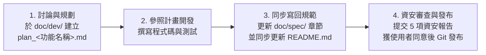

# 第 04 章：擴充 SOP、文件生命周期與資料庫策略

> **章節狀態**：已正式生效並同步寫入 [AGENTS.md](../../AGENTS.md) 與 [DESIGN.md](../../DESIGN.md)。

---

## 4.1 計畫先行、完工回寫之文件生命周期 (Doc Lifecycle)

為了維持多人或 AI 持續協作的一致性，所有功能開發與修改一律遵循以下四步循環：

1. **開發前（`doc/dev/plan_<功能名稱>.md`）**：先與使用者討論需求，產出開發計畫書放入 `doc/dev/`，明確列出修改範圍、目錄異動與驗收條件。
2. **開發中**：嚴格參照該計畫書執行，不隨意偏離架構。
3. **開發完成後或換電腦接手時（回寫 `doc/spec/` 與 `README.md` — 跨環境無縫接軌機制）**：
   - **設計目的**：當使用者在不同電腦環境（如公司、家裡、筆電）切換維護同一個專案時，只需閱讀 `doc/spec/` 即可 100% 掌握系統目前實際樣貌（As-Is）並立即接手開發。
   - **強制落差檢查（Spec Drift Check）**：每次功能完成後（或在新環境接手發現實作已超前規格時），必須逐章核對 `doc/spec/00_overview.md` 至 `04_workflow_and_database_policy.md` 是否與實際檔案結構、工具版本、JSON 設定檔及伺服器行為完全吻合；若有落差，**`doc/spec/` 必須立即更新跟上實作成果**。
   - **強制同步更新根目錄 `README.md`**（含工具清單、目錄樹、最新更新紀錄）。

---

## 4.2 🗄️ 資料庫強制架構策略（SQLite + 獨立 Git 分支）

> [!IMPORTANT]
> **資料庫演進鐵律（Database Evolution Rule）**  
> 目前「蘇的工具箱」第一階段工具皆為純前端靜態應用（使用瀏覽器 `localStorage` 或匯入/匯出檔案）。  
> **未來若任何新工具或既有工具改版需要引入後端資料庫（Database）時，強制遵守以下兩大原則：**
> 1. **強制先開立新的 Git 分支（Branch）**：例如 ` git checkout -b feat/sqlite-<工具或功能名稱>`，絕對不可直接在 `main` 主分支上直接混入後端資料庫架構，確保純靜態版本隨時可退回且不受影響。
> 2. **後端資料庫統一採用 SQLite**：
>    - 選用輕量、單一檔案、免安裝龐大 DB 伺服器的 **SQLite**（例如 Node.js 環境使用內建 `node:sqlite` 或 `better-sqlite3`）。
>    - 資料庫檔案（`*.sqlite`, `*.sqlite3`, `*.db` 以及 WAL 模式下的 `*.db-wal`, `*.db-shm`, `*.sqlite-wal`, `*.sqlite-shm`）必須存放於受保護的資料目錄，並預設加入 `.gitignore`（除非是已脫敏的空結構樣板 `schema.sql`），同時在 `server.js` 中禁止透過靜態 HTTP 直接下載資料庫與交易日誌檔案，且伺服器維持 `127.0.0.1` 本機綁定。
>    - 所有 SQL 查詢**強制使用參數化查詢（Parameterized Queries / Prepared Statements）**，徹底杜絕 SQL Injection。
